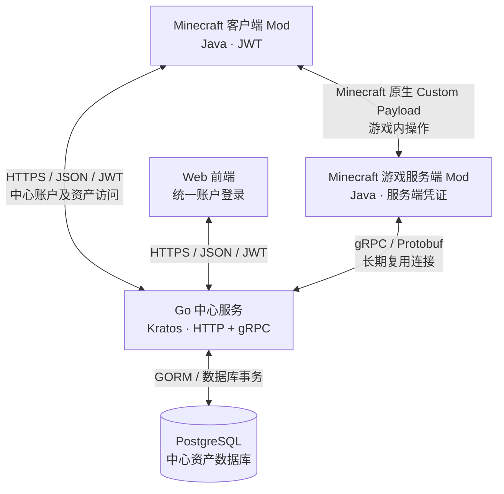

# Minecraft 多服互联与共享资产系统

> **RealmMesh 项目技术与需求草案 v0.3**  
> 整理日期：2026-10-18  
> 状态：需求基线草案；仓库组织方案已确认，业务细节与分阶段计划仍待审查。
> 来源：用户提供的 `minecraft_multi_server_assets_technical_draft.md`，结合 2026-10-18 用户确认的四仓库方案整理。原始文件未修改。
> 本版更新：确认 Kratos 与手写 HTTP API，按玩家游戏名字统一账户，更新中心认证、失败休息、游戏服凭证管理与审计边界；保留其他已记录的工程进度。

## 1. 项目目标与定位

开发一套面向 Minecraft Java 版多服务器的共享资产系统，使玩家能够在多个游戏服务器之间使用统一的中心账户，管理虚拟货币和物品等资产。

系统由 **Minecraft 客户端 Mod、Minecraft 游戏服务端 Mod、独立 Go 中心服务** 构成，并允许玩家**不进入任何游戏服务器**，直接通过网页等方式登录、查询和管理中心资产。

项目主要目标：

- 支持多台 Minecraft 游戏服务器接入同一个中心资产服务。
- 支持统一中心账户，以及游戏内和 Web 端的资产访问。
- 支持虚拟货币和物品两类资产；具体资产模型和业务规则暂不细化。
- 支持不同服务器具有不同的模组组合：目标服务器无法识别或恢复的物品，拒绝取出，不强求所有服务器安装相同模组。
- 重视高并发、长期连接和资产一致性，尤其是同一账户从多个入口并发操作时的数据安全。
- 优先选择成熟框架、第三方库及现有生态，降低开发与维护成本，**不以依赖少或极致轻量为设计目标**。
- 项目将以**开发者亲自手敲代码、分阶段逐步实现**为主要开发方式，不以一次性生成完整项目为目标。

## 2. 系统角色与职责

### 2.1 Minecraft 客户端 Mod（Java）

- 提供玩家资产界面及游戏内交互入口。
- 接入中心统一账户体系；进服登录通过游戏服提交中心校验，直接访问中心 HTTP API 时使用独立的 HTTP 登录状态。
- 可直接使用中心服务提供的 HTTP API 登录、查询和执行纯中心资产操作。
- 对涉及 Minecraft 背包、物品生成或扣除的操作，通过 Minecraft 原生网络通信交给当前游戏服务器执行。
- **客户端不是游戏物品真实性或背包状态的可信来源。**

### 2.2 Minecraft 游戏服务端 Mod（Java）

- 运行在接入系统的 Minecraft 游戏服务器中。
- 验证当前连接玩家的游戏内身份及背包、物品状态。
- 检查物品是否在本服存在，必要时判断是否能够读取、恢复相关物品数据。
- 执行真正影响游戏内状态的操作，例如扣除背包物品、向玩家背包发放物品。
- 通过受认证的 gRPC 连接与中心服务交换资产操作请求及结果。
- 每次进服要求登录，由中心校验；本服内存维护在线与登录状态，通过原生数据包交互，不建立额外的中心游戏会话契约。

### 2.3 Go 中心服务

- 管理以游戏名字为唯一用户名的中心账户、登录认证、失败次数与休息时间、服务器接入身份和权限。
- 提供面向客户端 Mod、Web 前端的 HTTP API。
- 提供面向 Minecraft 游戏服的 gRPC API。
- 维护共享虚拟货币、共享物品等中心资产数据及其业务状态。
- 负责中心资产的并发协调与数据库事务，维护统一的权威资产记录。
- 协调需要游戏服实际执行的资产操作，但**不直接操作 Minecraft 游戏背包**。

### 2.4 Web 前端（后续开发）

- 不依赖 Minecraft 游戏连接，直接访问 Go 中心服务。
- 使用与客户端 Mod 统一的中心账户及登录认证体系。
- 可查看中心资产并执行只涉及中心资产账本的操作。
- 具体前端框架、页面功能范围和管理后台形态暂未决定。

## 3. 总体架构与通信拓扑

**原则：两条不同的业务路径。**

1. **纯中心资产操作**：客户端 Mod 或 Web → Go 中心服务 → PostgreSQL。玩家无需在线进入游戏服。
2. **涉及游戏世界状态的操作**：客户端 Mod → Minecraft 游戏服 Mod ↔ Go 中心服务。真实物品的扣除或发放必须由游戏服务器执行。

Minecraft 客户端与中心服务之间不强制保持 gRPC 长连接。游戏服务器可为中心 RPC 复用长期 gRPC Channel，承载多个玩家的并发请求；需要中心主动发送消息时，再根据需求使用 gRPC Streaming。

## 4. 当前技术选型

### 4.1 选型总表

| 层级 | 技术 | 当前状态 / 说明 |
| --- | --- | --- |
| Minecraft 客户端及服务端 Mod | **Java** | 明确选择 |
| Minecraft 模组加载器 | **NeoForge 1.21.1 优先**；预留 Fabric / Forge | 首期仅开发和测试 NeoForge；其余两端后续开发，不宣称已支持 |
| Mod 构建 | Gradle + MultiLoader-Template | 采用 1.21.1 工程组织；具体插件及依赖版本在初始化时核实 |
| 多加载器复用 | **MultiLoader 的 common + 加载器子项目** | 已确认；不以 Architectury API 为基础依赖 |
| 多 MC 版本维护 | Stonecutter（按需） | 可选，不作为第一阶段必选依赖 |
| 中心服务开发语言 | **Go** | 明确偏好，当前确定方向 |
| Go 服务框架 | **Kratos** | 已确认；HTTP 路由与请求结构手写，不从 Protobuf 生成 |
| 游戏服 ↔ 中心 | **gRPC over HTTP/2 + Protobuf** | 当前推荐方案，待模组打包兼容性验证 |
| Go RPC 实现 | grpc-go（由 Kratos 集成） | 与 gRPC 方案配套 |
| Java RPC 实现 | grpc-java，优先 grpc-netty-shaded | 与 gRPC 方案配套，降低 Netty 依赖冲突风险 |
| IDL / 生成代码 | Protobuf（proto3）+ protoc + 各语言插件 | 四仓库独立构建；Git Submodule 固定协议提交，手动管理版本；不引入 Buf Schema Registry 等额外托管平台 |
| 客户端 / Web ↔ 中心 | **HTTPS + JSON** | 当前确定方向 |
| 客户端 ↔ 游戏服 | Minecraft 原生 Custom Payload | 当前确定方向 |
| 中心数据库 | **PostgreSQL** | 当前确定方向 |
| ORM | **GORM** | 当前暂定选型；不采用完全手写 SQL 的业务开发方式 |
| 用户登录鉴权 | 中心统一账号密码校验；直接 HTTP 访问沿用 JWT 方向 | 游戏服本地维护已登录状态，不额外签发游戏会话票据 |
| 游戏服鉴权 | `server_id` + `server_secret`；传输采用 TLS 方向 | 管理员登记，支持停用、轮换、删除；凭证明文保存于 `config/<mod名>/` 下 |
| Web 前端技术栈 | 待定 | 后续单独讨论 |

### 4.2 为什么选 gRPC + Protobuf

- Go 和 Java 都有成熟的实现及跨语言代码生成生态。
- 适合请求/响应型的资产操作，也支持服务端流、双向流以满足后续推送需求。
- 已提供调用约定、状态码、超时与取消、拦截器等通用机制，减少重复开发。
- 与手工维护 WebSocket 消息关联协议、Netty 自定义 TCP 协议相比，更符合本项目“成熟生态优先”的原则。
- 目前没有足够理由引入 QUIC、自定义二进制封包或 Apache Thrift 作为首选。

推荐**复用长期 gRPC Channel，普通资产请求优先使用 Unary RPC**。Streaming 只在确有持续双向消息需求时启用，不必把所有操作统一放在单条双向流中。

> 工程验证项：游戏服 Mod 引入 grpc-java 时，需要验证目标 Minecraft 加载器的依赖打包、传递依赖和与游戏内 Netty 的兼容性。`grpc-netty-shaded` 可降低部分冲突风险，但并不替代实际测试。

### 4.3 ORM 与数据库

- 使用 GORM 映射实体、完成常规数据库操作和事务处理；复杂查询允许按需使用 SQL，不要求做到“零 SQL”。
- PostgreSQL 作为中心资产数据的权威存储。
- 可以利用事务、行级锁处理同一账户的冲突写入。
- 暂不因“高并发”而强制引入 Redis 分布式锁、Kafka、RabbitMQ 或分布式事务平台；出现明确需求或瓶颈后再引入。

## 5. 一致性与并发原则

这里先固定目标，不提前写完整事务状态机或所有异常分支。

1. **不同玩家可并发**，不应为了保护同一玩家的数据而把所有玩家的请求全局串行化。
2. **同一玩家相关的资产变更要互斥或串行处理**，无须保证两个并发请求谁先执行。
3. 冲突时可以快速拒绝并提示用户重试，不要求复杂的排队公平性和严格时序。
4. 中心数据库内的资产变更以 PostgreSQL 事务保障一致性，可考虑行级锁和 `NOWAIT` 等机制。
5. **游戏背包和 PostgreSQL 不是同一个事务域**：仅靠 ORM 事务无法原子完成“游戏内扣物品 + 中心入库”，也无法原子完成反向取出。
6. 涉及游戏服的资产转移至少需要能够**识别请求、避免重试重复扣除或重复发放、记录未完成操作**。具体最小实现方案后续单独设计。
7. 不应在等待游戏服务器长时间响应期间一直占用数据库行锁；跨系统未完成操作需单独协调。

高并发、长连接和强一致性是目标，但**不以提前搭建复杂分布式体系为代价**。对数据库内部可直接使用成熟事务机制；对游戏服与中心之间的跨系统操作，先研究最小且可恢复的方案。

## 6. 账户、认证和信任边界

- 中心账户全局唯一，玩家 ID 就是游戏名字，忽略大小写，不建立 Minecraft UUID 与中心账户绑定流程。
- 任意节点的注册和登录都提交中心校验，跨服务器使用同一套账号密码，不重复注册或维护本地账户库。
- 游戏服每次检测玩家进入都要求重新登录；内存维护在线与已登录状态，通过 Minecraft 原生数据包交互，不建立中心连接或会话授权契约。
- 中心按规范化玩家 ID 统一累计失败次数；超过配置次数进入可配置休息期，游戏服按结果踢出。重连与换服不重置计数；第 N+1 次失败触发休息（N 为配置允许次数），休息期内即使密码正确也不能登录；到期从零重新计数。成功登录清零，注册成功自动登录。不执行 IP 或永久 ID 封禁。
- 管理员预先登记服务器，凭证为 `server_id` 与 `server_secret`，明文保存在服务器 `config/<mod名>/` 目录；支持停用、轮换和删除。
- 游戏服负责从真实连接取得玩家名字并检查本地登录状态，中心验证服务器身份与业务权限。当前方案信任运营方授权的游戏服，不声称能够防止恶意游戏服伪造玩家操作。
- 上下线与 RealmMesh 相关交互记录到中心审计日志；不记录全部游戏行为，也不记录密码或密钥。
- 玩家离线仍可通过 Web 使用同一中心账户访问资产；直接 HTTP 登录沿用 JWT 方向，不将 HTTP 令牌交给游戏服保存。

完整流程、协议职责与待定细节见 [认证流程与协议职责](AUTHENTICATION.md)。

## 7. 不同模组与物品兼容

- 不要求接入的所有服务器都安装完全相同的模组。
- 中心服务负责保管物品资产记录，但不负责直接加载或执行 Minecraft 模组代码。
- 存储物品时需要保留其标识及恢复所需的数据；具体序列化方案待目标 MC 版本确定后设计。
- 玩家在某服取出物品时，由**目标游戏服**验证本服是否支持对应的物品及其数据。
- 若缺少对应模组、物品不存在或无法安全恢复，则**拒绝取出，中心资产不得因此丢失**。
- 需要留意不同 MC 版本、不同 Mod 版本可能导致同一物品的数据结构不兼容；暂不承诺跨所有版本通用。

## 8. 项目工程组织（已确认）

采用 GitHub Multi-repo + 手动版本管理，仅使用以下四个仓库：

| 仓库 | 技术栈 | 职责 |
| --- | --- | --- |
| realmmesh-server | Go | 中心服务、RPC、身份认证、资产管理、数据库 |
| realmmesh-mod | Java | 客户端与游戏服务端 Mod、游戏事件、物品操作、RPC 客户端 |
| realmmesh-web | TypeScript | 玩家资产管理、管理后台、HTTP API 调用 |
| realmmesh-proto | Protobuf | 统一 RPC 接口与数据结构定义；当前同时存放跨仓库需求与计划 |

协议唯一来源是 `realmmesh-proto`。后续 Go、Java 仓库各通过 `proto/` Git Submodule 固定协议提交，在本仓库构建中生成对应语言代码；Web 通过 HTTP/JSON 调用中心服务，不引用协议仓库。

完整已确认约定见 [仓库组织与版本管理](REPOSITORIES.md)。Mod 最小工程已搭建并完成 NeoForge 1.21.1 基础启动验证；尚未创建 Submodule 或协议文件。

## 9. 分阶段开发计划（待审查）

详细阶段、依赖、交付物与验收条件见 [分阶段开发计划](DEVELOPMENT_PLAN.md)。计划采用小闭环逐步手写实现；Mod 最小工程已单独获准并完成基础验证，其余阶段仍按设计确认后实施。

计划将游戏服依赖兼容验证前置，并将幂等、未完成操作与恢复验证作为真实物品存取闭环的准入条件；不能把基础资产安全全部留到最终稳定性阶段。

## 10. 暂未确定的事项

以下内容**不能视为已确认需求**，留待后续逐项讨论：

- Fabric / Forge 两端的实施时间、具体支持范围及验收计划；首期 NeoForge 1.21.1 与 MultiLoader 工程方向已确认。
- 共享资产的详细数据结构、物品序列化方案与兼容策略。
- 密码策略与找回、改名规则、HTTP JWT 过期与续签方式。
- 休息期内尝试是否延长时间、不存在账户及注册失败如何纳入限制，以及计数持久化方式；详见认证文档。
- 审计补报、去重、持久化失败处理及服务器删除的历史记录保留方式。
- 游戏内存入、取出时的跨系统操作顺序、超时恢复及幂等方案。
- 虚拟货币、物品转移、交易等具体业务操作及权限规则。
- Web 前端框架、管理后台、界面与交互设计。
- 是否需要中心主动实时推送，以及具体的 Streaming 接口。
- 服务部署、实例扩展、监控、备份和数据库迁移的最终方案。

## 11. 当前结论

**已明确的方向**：Java Minecraft Mod、Go 中心服务、统一中心账户与 JWT、离线 Web 资产管理、游戏服作为游戏物品可信执行节点、PostgreSQL 资产存储、同账户冲突操作串行化或拒绝重试。

**目前优先采用的技术组合**：Go **Kratos + GORM + PostgreSQL**，游戏服与中心使用 **gRPC + Protobuf**，Web 与客户端 Mod 使用 **HTTPS + JSON**，客户端与游戏服使用 **Minecraft 原生数据包**。

**开发方式**：优先使用成熟框架与生态，围绕小而完整的目标逐步手写代码；在实际需求出现之前，不引入复杂分布式系统或超出必要程度的抽象。
